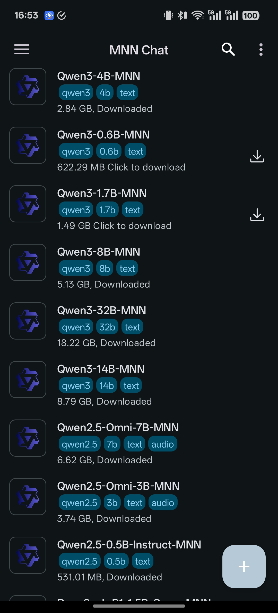
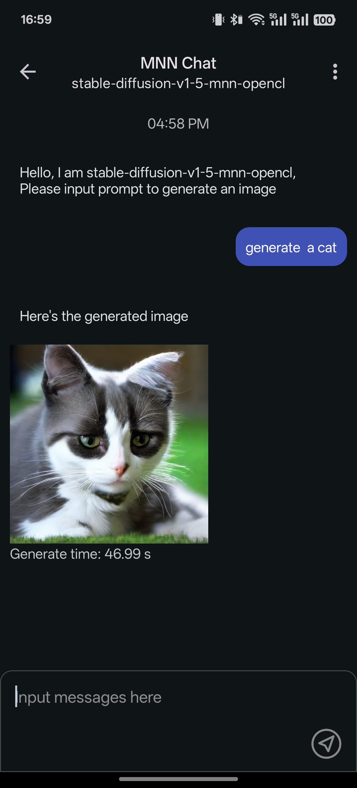
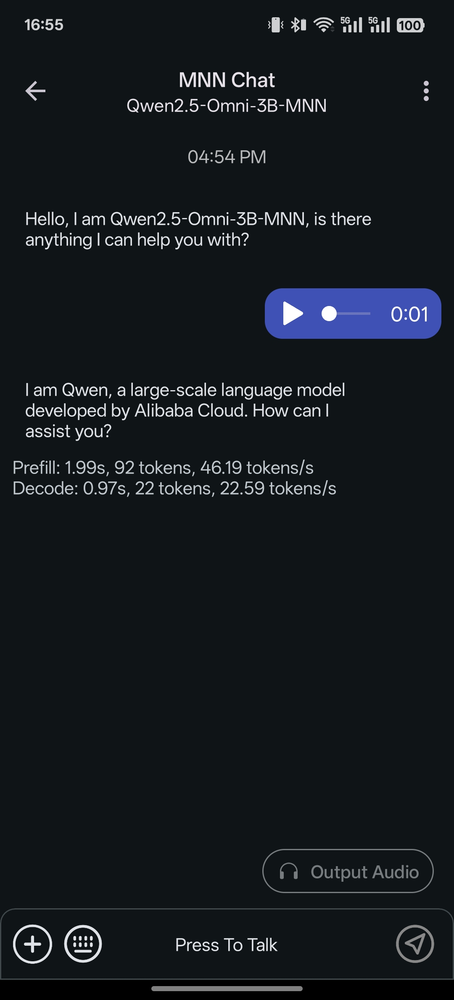
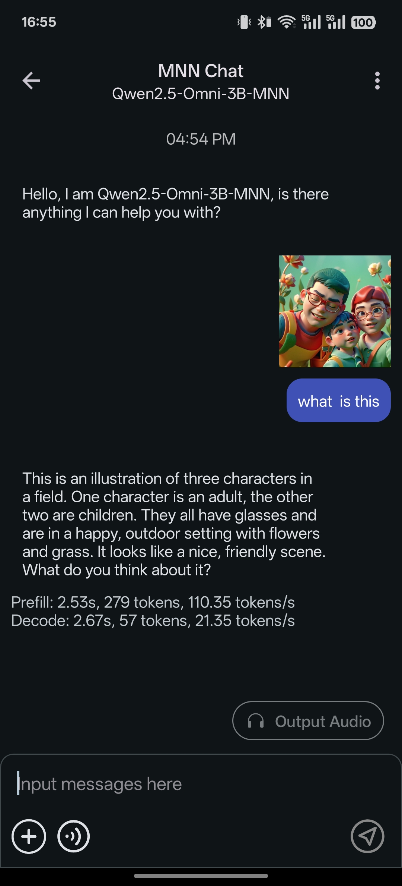

# MNN Chat Android App

> ## HNN CN ET  
>
>
> - 仓库：<https://github.com/ETQWFD/HNN-CN-ET>
> - 官网 / 下载统计：<https://etqwfd.github.io/HNN-CN-ET/> （下载量面板：<https://etqwfd.github.io/HNN-CN-ET/dan.html>）
> - Release APK：见仓库 [Releases](https://github.com/ETQWFD/HNN-CN-ET/releases)，通用包 `HNN-CN-ET-<版本>.apk`，同时包含 `armeabi-v7a`(32位) 与 `arm64-v8a`(64位) 原生库；两架构的核心库（libMNN/libmnnllmapp/libmnn_tts）与语音识别库（libsherpa-mnn-jni，ASR）均齐备且功能对齐。
> - 联系作者：<mailto:2416444244@qq.com> ｜ QQ 群：917902000
> - 修改点：双 ABI 打包、**32 位语音识别（sherpa-mnn）从 alibaba/MNN 3.6.0 源码为 armeabi-v7a 编译，与 64 位 JNI 接口完全对齐**、语音库加载异常保护（缺库不崩溃）、应用内自更新（走本仓库 GitHub Releases，支持断点续传/失败重试/进度速度）、内置应用日志页（可复制/分享）、设置内“联系作者/加入QQ群”、模型下载健壮性增强（自动重定向、超时、206/200 正确处理）。
> - 许可：保留上游 MIT 版权（见 `LICENSE`）；本次修改 Copyright (c) 2026 ET

[簡体中文版本](./README_CN.md) | [繁體中文版本](./README_TW.md)

[Download](#releases)  [下载](./README_CN.md#releases)

## Introduction
This is our full multimodal language model (CN ET) Android app
<p align="center">
  
  
  
  
</p>


### Features

+ **Multimodal Support:** Enables functionality across diverse tasks, including text-to-text, image-to-text, audio-to-text, and text-to-image generation (via diffusion models).

+ **CPU Inference Optimization:** MNN-LLM demonstrates exceptional performance in CPU benchmarking in Android, achieving prefill speed improvements of 8.6x over llama.cpp and 20.5x over fastllm, with decoding speeds that are 2.3x and 8.9x faster, respectively. the following is a comparison between llama.cpp and MNN-LLM on Android inferencing qwen-7b.

+ **Broad Model Compatibility:** Supports multiple leading model providers, such as Qwen, Gemma, Llama (including TinyLlama and MobileLLM), Baichuan, Yi, DeepSeek, InternLM, Phi, ReaderLM, and Smolm.

+ **Privacy First:** Runs entirely on-device, ensuring complete data privacy with no information uploaded to external servers.


# How to Use
+ you can download the app from [Releases](#releases) or [build it yourself](#development);
+ After installing the application, you can browse all supported models, download them, and interact with them directly within the app.;
+ Additionally, you can access your chat history in the sidebar and revisit previous conversations seamlessly.

 !!!warning!!! This version has been tested exclusively on the OnePlus 13 and Xiaomi 14 Ultra, Due to the demanding performance requirements of large language models (LLMs), many budget or low-spec devices may experience issues such as slow inference speeds, application instability, or even failure to run entirely. and its stability on other devices cannot be guaranteed. If you encounter any issues, please feel free to open an issue for assistance.


# Development
+ Prepare
  + Android Studio
  + NDK (align with `app/build.gradle`, current: `27.2.12479018`)
  + `export ANDROID_NDK=${YOUR_NDK_ROOT}`
+ Clone the repository:
  ```shell
    git clone https://github.com/alibaba/MNN.git
  ```
+ Build library:
  ```shell
  cd project/android
  mkdir build_64
  cd build_64
  ../build_64.sh "-DMNN_LOW_MEMORY=true -DMNN_CPU_WEIGHT_DEQUANT_GEMM=true -DMNN_BUILD_LLM=true -DMNN_SUPPORT_TRANSFORMER_FUSE=true -DMNN_ARM82=true -DMNN_USE_LOGCAT=true -DMNN_OPENCL=true -DLLM_SUPPORT_VISION=true -DMNN_BUILD_OPENCV=true -DMNN_IMGCODECS=true -DLLM_SUPPORT_AUDIO=true -DMNN_BUILD_AUDIO=true -DMNN_BUILD_DIFFUSION=ON -DMNN_SEP_BUILD=OFF -DCMAKE_SHARED_LINKER_FLAGS='-Wl,-z,max-page-size=16384' -DCMAKE_INSTALL_PREFIX=."
  make install
  ```

+ build android app project and install
  ```shell
  cd ../../../apps/Android/MnnLlmChat
  ./installDebug.sh
  ```

